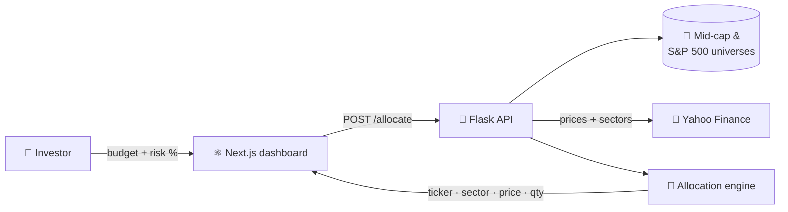
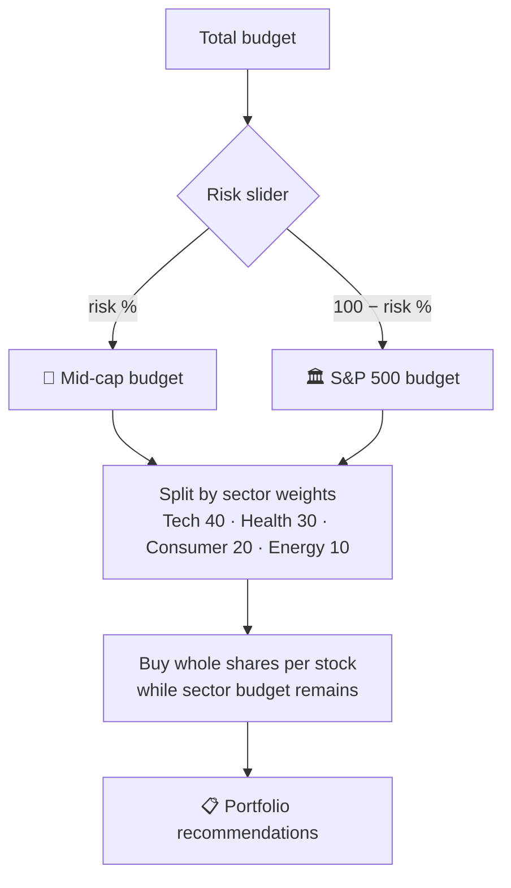

<p align="center">
  
</p>

<p align="center">
  
  
  
  
  
  
  
</p>

<p align="center">
  <b>Tell OptiStocks how much you want to invest and how much risk you can stomach.<br/>It builds a diversified, sector-balanced stock portfolio from live market prices in seconds.</b>
</p>

---

## ✨ Highlights

- 💰 **Budget in, portfolio out:** enter a dollar amount and get back exactly which stocks to buy and how many shares of each
- 🎚️ **Risk slider:** controls the split between **mid-cap stocks** (higher growth, higher risk) and **S&P 500 large caps** (more stable)
- 🧺 **Sector diversification:** capital is spread across sectors with target weights (Technology 40% · Healthcare 30% · Consumer Goods 20% · Energy 10%)
- ⏱️ **Live market data:** real-time prices and sector classification pulled from Yahoo Finance via `yfinance`
- 🧮 **Whole-share allocation:** buys only whole shares and tracks the remaining budget so the portfolio never goes over
- 🖥️ **Clean dashboard:** a Next.js + Tailwind frontend shows each pick's ticker, category, sector, price and quantity

Built where my two majors meet: **computer science + economics**.

---

## 🏗️ How It Works



### The allocation engine



---

## 📡 API

**`POST /allocate`**

```json
// request
{ "budget": 10000, "risk": 60 }

// response
[
  { "Category": "Mid Cap", "Sector": "Technology", "Symbol": "XYZ", "Price": 42.10, "Quantity": 12 },
  { "Category": "S&P 500", "Sector": "Healthcare", "Symbol": "ABC", "Price": 118.55, "Quantity": 3 }
]
```

---

## 🚀 Getting Started

### Backend
```bash
git clone https://github.com/JeevanJyot55/OptiStocks.git
cd OptiStocks/cheesybackend
pip install flask flask-cors yfinance pandas tqdm
python stockSelectorFunctions.py      # runs on http://127.0.0.1:5000
```

### Frontend
```bash
cd ../cheesyfrontend
npm install
npm run dev                           # http://localhost:3000
```

---

## 📁 Project Structure

```
OptiStocks/
├── cheesybackend/
│   ├── stockSelectorFunctions.py   # Flask API + allocation engine
│   ├── mid-cap.csv                 # Mid-cap stock universe
│   └── s&p500.csv                  # S&P 500 universe with sectors
└── cheesyfrontend/
    ├── components/OptiStock.tsx    # Budget input, risk slider, results
    └── src/app/                    # Next.js app router
```

---

## 🗺️ Roadmap

- [ ] 📊 Momentum and RSI scoring to rank stocks within each sector
- [ ] ⏪ Historical back-testing of generated portfolios
- [ ] 🎛️ User-defined sector weights
- [ ] 📰 News sentiment signals
- [ ] 🔐 Accounts and saved portfolios
- [ ] ⚡ Caching of price and sector lookups for faster responses

> ⚠️ *For educational purposes only. Not financial advice.*

---

<p align="center">
  Built by <a href="https://github.com/JeevanJyot55"><b>Jeevan Jyot Singh</b></a> · <a href="https://www.linkedin.com/in/jeevanjyotsingh">LinkedIn</a> · <a href="https://jeevanjyot55.github.io">Portfolio</a>
</p>
